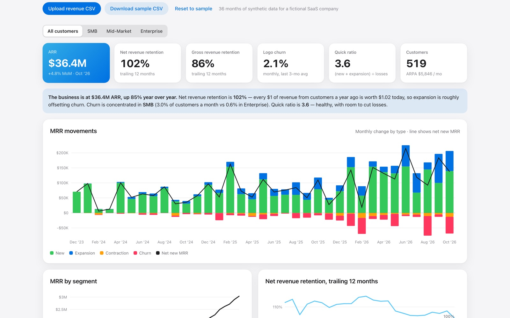

# Cohort Lab

SaaS revenue analytics: ARR, MRR movements, net and gross revenue retention, churn, quick ratio, and cohort heatmaps from raw subscription data.

**[Live demo →](https://darshanpatil.me/work/cohort-lab/)**



## The problem

Every subscription business tracks the same handful of metrics: ARR, net revenue retention, churn, and quick ratio. Computing them correctly from raw billing data is surprisingly easy to get wrong (reactivations, partial months, expansion vs. new). Cohort Lab does it from one simple table.

## What it does

- Builds the **MRR bridge**: new, expansion, contraction, and churn each month, plus net new MRR.
- Tracks **trailing-12-month NRR and GRR** over time.
- Reports **ARR, logo churn, quick ratio, customers, and ARPA**.
- Draws **cohort heatmaps** by first paying month, in revenue-retention or customer-retention mode.
- Filters everything by **segment** (SMB, Mid-Market, Enterprise) and writes a plain-English summary.
- Accepts your own data as CSV.

## Definitions

- **New:** MRR from customers with no revenue the month before (includes reactivations).
- **Expansion / contraction:** month-over-month increases or decreases from continuing customers.
- **Churn:** last month's MRR from customers with no revenue this month.
- **NRR:** current MRR from customers active 12 months ago ÷ their MRR then.
- **GRR:** the same, with each customer capped at their MRR then (losses only).
- **Quick ratio:** (new + expansion) ÷ (contraction + churn).

**CSV format:** `customer_id, month (YYYY-MM), mrr`, optional `segment`. One row per customer per paying month.

The sample company is fictional. Its data is generated with segment-specific churn and expansion rates, with higher churn early in a customer's life.

## Run it locally

No build step and no dependencies. Serve the folder with any static server:

```bash
python3 -m http.server 8000
# open http://localhost:8000
```

## Project structure

```
index.html   page layout and copy
app.js       data generation, model, and rendering
app.css      page-specific styles
kit.js       shared helpers: seeded RNG, CSV import/export, SVG charts, tooltips
kit.css      shared UI kit (light + dark mode)
```

Charts are hand-built SVG with no charting library. Everything runs client-side, so uploaded files never leave the browser.

## Data

The bundled sample data is **synthetic**, generated from a seeded random process so it is reproducible. It does not describe any real company or customer.

---

Built by [Darshan Patil](https://darshanpatil.me) · [LinkedIn](https://www.linkedin.com/in/darshan-patil-/)
